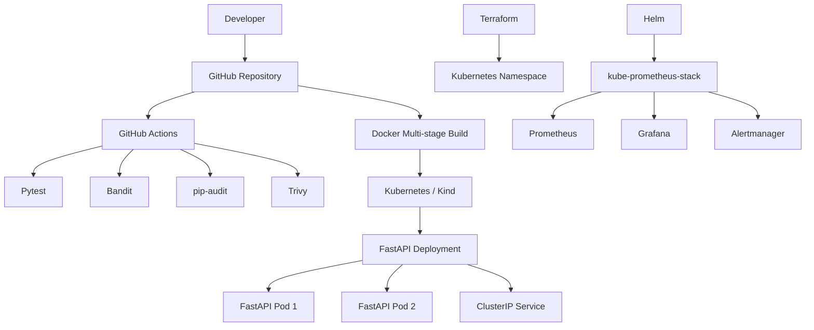
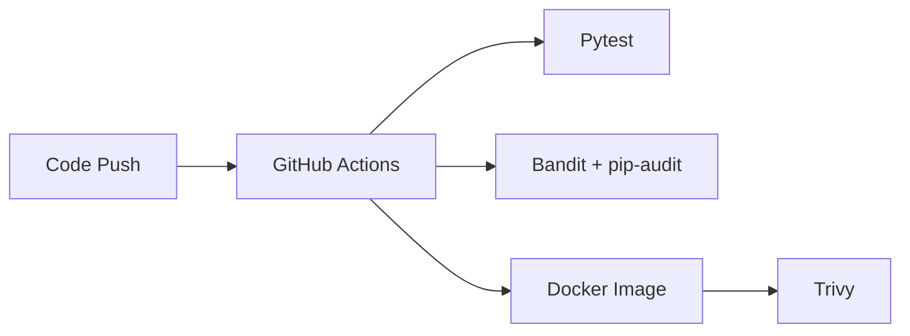

# 🚀 DevSecOps Platform

### End-to-End DevSecOps Project | CI/CD • Security • Docker • Kubernetes • Terraform • Monitoring

[](../../actions)


---

## 📖 Overview

**DevSecOps Platform** is a complete, hands-on DevSecOps portfolio project demonstrating the integration of software development, automated testing, security scanning, containerization, Kubernetes orchestration, Infrastructure as Code, and observability.

The project is built around a **Python FastAPI REST API**, containerized with **Docker**, deployed on **Kubernetes using Kind**, and supported by **GitHub Actions, Terraform, Helm, Prometheus, Grafana, and Alertmanager**.

It demonstrates practical experience with modern DevSecOps tools and workflows.

## ✨ Key Features

- **REST API:** Python application developed with FastAPI.
- **Automated Testing:** API validation with Pytest.
- **Continuous Integration:** GitHub Actions workflow.
- **Static Security Analysis:** Python code scanning with Bandit.
- **Dependency Security:** Vulnerability auditing with pip-audit.
- **Container Security:** Docker image scanning with Trivy.
- **Containerization:** Multi-stage Docker build with a non-root runtime user.
- **Container Orchestration:** Kubernetes Deployment with two FastAPI replicas.
- **Infrastructure as Code:** Kubernetes resource management with Terraform.
- **Monitoring:** Prometheus metrics, Grafana dashboards, and Alertmanager.
- **Automation:** Bash script for local Kubernetes deployment.
- **Documentation:** Architecture, deployment, and security guides.

## 🏗️ Architecture



The architecture combines automated quality and security controls with containerized application deployment and infrastructure monitoring.

For additional details, see the [Architecture Documentation](docs/architecture.md).

## 🛠️ Technology Stack

| Category | Technologies |
|---|---|
| Backend | Python, FastAPI |
| Testing | Pytest |
| CI/CD | GitHub Actions |
| SAST | Bandit |
| Dependency Security | pip-audit |
| Container Security | Trivy |
| Containerization | Docker |
| Orchestration | Kubernetes, Kind |
| Infrastructure as Code | Terraform |
| Kubernetes Package Management | Helm |
| Monitoring | Prometheus |
| Visualization | Grafana |
| Alerting | Alertmanager |
| Automation | Bash |
| Development Environment | GitHub Codespaces |

## 📁 Project Structure

```text
devsecops-platform/
├── .github/
│   └── workflows/
│       └── ci.yml
├── app/
│   └── main.py
├── docs/
│   ├── architecture.md
│   ├── deployment.md
│   └── security.md
├── kubernetes/
│   ├── deployment.yaml
│   ├── service.yaml
│   └── monitoring-values.yaml
├── scripts/
│   └── start-local.sh
├── terraform/
│   ├── main.tf
│   ├── variables.tf
│   └── outputs.tf
├── tests/
│   └── test_api.py
├── .dockerignore
├── .gitignore
├── Dockerfile
├── README.md
├── requirements.txt
└── requirements-dev.txt
```

## 🐍 FastAPI Application

The application exposes a health-check endpoint.

**Endpoint**

```http
GET /health
```

**Expected response**

```json
{
  "status": "healthy"
}
```

FastAPI also provides interactive API documentation at:

`http://localhost:8000/docs`

### Run Locally

Create and activate a virtual environment:

```bash
python -m venv .venv
source .venv/bin/activate
```

Install dependencies:

```bash
pip install -r requirements.txt
pip install -r requirements-dev.txt
```

Run the application:

```bash
uvicorn app.main:app --host 0.0.0.0 --port 8000
```

Test the health endpoint:

```bash
curl http://localhost:8000/health
```

## 🧪 Automated Testing

The project includes API tests implemented with Pytest.

Run the tests:

```bash
pytest -v
```

The tests help verify application behavior and detect regressions.

## 🐳 Docker

The application is packaged using a multi-stage Dockerfile.

The container image follows security best practices, including a non-root runtime user and a reduced image footprint.

Build the image:

```bash
docker build --no-cache --pull -t devsecops-api:local .
```

Run the container:

```bash
docker run --rm -p 8000:8000 devsecops-api:local
```

Verify the API:

```bash
curl http://localhost:8000/health
```

## 🔐 DevSecOps Security Pipeline

Security controls are integrated into the GitHub Actions CI workflow.

| Tool | Purpose |
|---|---|
| Pytest | Automated API testing |
| Bandit | Python static security analysis |
| pip-audit | Dependency vulnerability auditing |
| Trivy | Container image vulnerability scanning |

This approach applies **shift-left security** principles by incorporating security checks early in the development lifecycle.

Additional security measures include:

- Non-root Docker execution.
- Kubernetes security context.
- Kubernetes resource requests and limits.
- Health and readiness probes.
- Exclusion of sensitive local files using `.gitignore` and `.dockerignore`.

See the [Security Documentation](docs/security.md).

## ☸️ Kubernetes Deployment

The FastAPI application runs on Kubernetes using Kind.

The deployment includes:

- **Two FastAPI replicas.**
- A Kubernetes Deployment.
- A ClusterIP Service.
- Health probes.
- CPU and memory resource configuration.

### Automated Local Deployment

From the project root:

```bash
bash scripts/start-local.sh
```

The script automates cluster creation, Docker image construction, image loading, Kubernetes manifest application, and rollout verification.

### Kubernetes Verification

```bash
kubectl get deployments
kubectl get pods
kubectl get services
```

See the [Deployment Guide](docs/deployment.md) for the complete procedure.

## 🟣 Infrastructure as Code — Terraform

Terraform is used to manage Kubernetes infrastructure declaratively.

The Terraform configuration includes:

- Kubernetes provider configuration.
- A Kubernetes namespace resource.
- Configurable input variables.
- Infrastructure outputs.

Example workflow:

```bash
cd terraform
terraform init
terraform validate
terraform plan
terraform apply
```

The default Kubernetes context is `kind-devsecops`.

## 📊 Monitoring and Observability

The project integrates the **kube-prometheus-stack** Helm chart.

### Prometheus

Collects and stores monitoring metrics.

### Grafana

Provides dashboards for visualizing infrastructure and service metrics.

### Alertmanager

Manages alerts generated by Prometheus.

### Monitoring Verification

```bash
kubectl get pods -n monitoring
helm list -n monitoring
```

Grafana can be accessed through a Kubernetes port-forward:

```bash
kubectl port-forward -n monitoring svc/monitoring-grafana 3000:80
```

Then open:

`http://localhost:3000`

The complete installation procedure is available in the [Deployment Guide](docs/deployment.md).

## 🚀 CI/CD Workflow

The GitHub Actions workflow is defined in:

`.github/workflows/ci.yml`

The workflow integrates automated application testing and security scanning.



Kubernetes deployment is automated locally through `scripts/start-local.sh`.

## ✅ Project Validation

The project brings together the following tested components and workflows:

| Component | Validation |
|---|---|
| FastAPI | Health endpoint |
| Pytest | Automated API tests |
| Docker | Image build and container execution |
| Kubernetes | Application deployment with two replicas |
| Terraform | Kubernetes infrastructure management |
| Helm | Monitoring stack installation |
| Prometheus | Monitoring service |
| Grafana | Dashboard access |
| Alertmanager | Alerting component |

The local environment runs in GitHub Codespaces. Depending on the Codespace lifecycle, Docker and Kind resources may need to be recreated between sessions.

## 📚 Documentation

| Document | Description |
|---|---|
| [Architecture](docs/architecture.md) | Technical architecture and components |
| [Deployment](docs/deployment.md) | Installation, deployment, and verification |
| [Security](docs/security.md) | Application, container, CI, and infrastructure security |

## 🎯 Skills Demonstrated

This project demonstrates hands-on experience in:

- Python backend development.
- Automated software testing.
- GitHub Actions CI workflows.
- Secure Docker image construction.
- Container vulnerability scanning.
- Kubernetes deployment and troubleshooting.
- Infrastructure as Code with Terraform.
- Kubernetes package management with Helm.
- Monitoring and observability.
- Bash automation.
- Technical documentation.

---

### DevSecOps Platform

**Building, securing, deploying, and monitoring cloud-native applications.**

