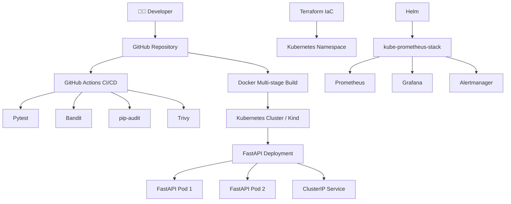

# 🏗️ Architecture DevSecOps Platform

**Architecture cloud-native | CI/CD | Security | Infrastructure as Code | Monitoring**


---

## 📌 1. Présentation

**DevSecOps Platform** est une plateforme DevSecOps basée sur une API REST développée avec **Python et FastAPI**.

Le projet intègre l'automatisation des tests, l'analyse de sécurité, la conteneurisation, l'orchestration Kubernetes, l'Infrastructure as Code et l'observabilité.

L'architecture repose sur les technologies suivantes :

- **FastAPI** pour le développement de l'API.
- **Docker** pour la conteneurisation.
- **GitHub Actions** pour l'intégration continue.
- **Pytest, Bandit, pip-audit et Trivy** pour la qualité et la sécurité.
- **Kubernetes et Kind** pour l'orchestration.
- **Terraform** pour l'Infrastructure as Code.
- **Helm** pour la gestion des composants Kubernetes.
- **Prometheus, Grafana et Alertmanager** pour la supervision.

## 🔄 2. Diagramme d'architecture



## 🧰 3. Stack technique

| Domaine | Technologies | Fonction |
|---|---|---|
| Backend | Python, FastAPI | API REST |
| Tests | Pytest | Validation applicative |
| Conteneurisation | Docker | Construction et exécution des images |
| CI | GitHub Actions | Automatisation des contrôles |
| SAST | Bandit | Analyse statique du code Python |
| Dépendances | pip-audit | Audit des vulnérabilités |
| Sécurité conteneurs | Trivy | Analyse des images |
| Orchestration | Kubernetes, Kind | Déploiement des applications |
| Infrastructure as Code | Terraform | Gestion déclarative des ressources |
| Packaging | Helm | Installation et configuration des composants |
| Monitoring | Prometheus | Collecte des métriques |
| Visualisation | Grafana | Tableaux de bord |
| Alerting | Alertmanager | Gestion des alertes |

## 🐍 4. Application FastAPI

L'application fournit une API REST avec un endpoint de vérification de santé.

**Endpoint :**

`GET /health`

**Réponse :**

```json
{
  "status": "healthy"
}
```

La documentation interactive Swagger est accessible via `/docs`.

L'application est accompagnée de tests automatisés avec Pytest.

## 🐳 5. Conteneurisation Docker

L'application utilise un Dockerfile multi-stage pour séparer les étapes de construction et d'exécution.

Les bonnes pratiques mises en œuvre comprennent :

- Une image Python slim.
- Une construction multi-stage.
- Un utilisateur applicatif non-root.
- Un fichier `.dockerignore`.
- L'analyse de sécurité des images avec Trivy.

**Construction de l'image :**

```bash
docker build --no-cache --pull -t devsecops-api:local .
```

## 🔐 6. Intégration continue et sécurité

Le pipeline GitHub Actions automatise les contrôles de qualité et de sécurité.

| Étape | Outil | Contrôle |
|---|---|---|
| Tests | Pytest | Vérification du comportement de l'API |
| SAST | Bandit | Détection des pratiques Python à risque |
| Audit | pip-audit | Recherche des vulnérabilités des dépendances |
| Scan d'image | Trivy | Analyse des vulnérabilités des conteneurs |

La sécurité est intégrée dans le cycle de développement afin de détecter les problèmes le plus tôt possible.

## ☸️ 7. Kubernetes

L'application est déployée sur un cluster Kubernetes local avec Kind.

L'architecture comprend :

- Un Deployment FastAPI avec **2 réplicas**.
- Un Service de type **ClusterIP**.
- Des sondes de santé Kubernetes.
- Des ressources CPU et mémoire définies.
- Un contexte de sécurité applicatif.

**Commandes de vérification :**

```bash
kubectl get deployments
kubectl get pods
kubectl get services
```

Les deux réplicas FastAPI ont été testés avec succès dans Kubernetes.

## 🟣 8. Infrastructure as Code avec Terraform

Terraform permet de gérer les ressources d'infrastructure à partir de fichiers déclaratifs.

Le projet contient :

```text
terraform/
├── main.tf
├── variables.tf
└── outputs.tf
```

La configuration utilise le provider Kubernetes et permet de gérer un namespace à travers des variables.

**Commandes Terraform :**

```bash
cd terraform
terraform init
terraform validate
terraform plan
terraform apply
```

## 📊 9. Observabilité et monitoring

La supervision s'appuie sur **kube-prometheus-stack**, installé et configuré avec Helm.

Elle rassemble les composants suivants :

| Composant | Fonction |
|---|---|
| Prometheus | Collecte et stockage des métriques |
| Grafana | Visualisation et tableaux de bord |
| Alertmanager | Gestion des alertes |
| Prometheus Operator | Gestion des ressources Prometheus |
| kube-state-metrics | Métriques des objets Kubernetes |
| Node Exporter | Métriques des nœuds |

**Vérification des composants :**

```bash
kubectl get pods -n monitoring
```

**Accès à Grafana :**

```bash
kubectl port-forward -n monitoring svc/monitoring-grafana 3000:80
```

Grafana est alors accessible sur `http://localhost:3000` pendant l'exécution du port-forward.

## 🚀 10. Automatisation du déploiement local

Le script `scripts/start-local.sh` automatise les opérations suivantes :

1. Vérification ou création du cluster Kind.
2. Construction de l'image Docker.
3. Chargement de l'image dans Kubernetes.
4. Application des manifestes.
5. Vérification de la disponibilité de l'application.

**Exécution :**

```bash
bash scripts/start-local.sh
```

## 🛡️ 11. Sécurité de l'architecture

Le projet applique plusieurs principes DevSecOps :

- Analyse statique du code.
- Audit des dépendances Python.
- Scan des images Docker.
- Exécution de l'application sans privilèges root.
- Configuration de sécurité Kubernetes.
- Limites de ressources.
- Exclusion des secrets et fichiers sensibles du dépôt Git.
- Automatisation des contrôles avec GitHub Actions.

## 🎯 12. Compétences démontrées

Ce projet met en pratique les compétences suivantes :

- Développement et tests d'une API Python.
- Construction et sécurisation d'images Docker.
- Configuration de pipelines CI.
- Analyse de sécurité automatisée.
- Déploiement et gestion de workloads Kubernetes.
- Infrastructure as Code avec Terraform.
- Packaging Kubernetes avec Helm.
- Supervision avec Prometheus et Grafana.
- Automatisation avec Bash.
- Documentation technique d'une architecture DevSecOps.

---

**DevSecOps Platform — Portfolio Project**

*Une architecture combinant automatisation, sécurité, infrastructure et observabilité.*