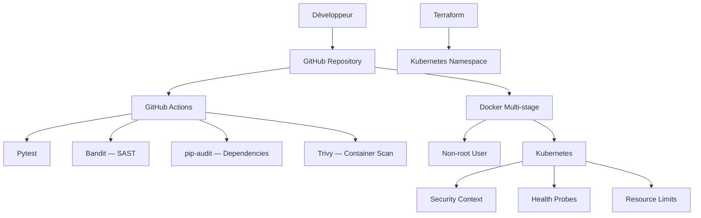

# 🔐 Security — DevSecOps Platform

**Application Security | Container Security | CI/CD Security | Kubernetes Security | Infrastructure as Code**

## 1. Présentation

La sécurité constitue un élément central de **DevSecOps Platform**.

Le projet intègre des contrôles de sécurité à plusieurs niveaux : code source, dépendances Python, images Docker, pipeline d'intégration continue et infrastructure Kubernetes.

Cette approche permet de détecter les vulnérabilités dès les premières étapes du développement et de renforcer la sécurité des déploiements.

## 2. Architecture de sécurité



## 3. Sécurité du code source

### Bandit — Static Application Security Testing

**Bandit** analyse le code Python afin de détecter des pratiques potentiellement dangereuses.

Les contrôles peuvent notamment identifier :

- L'utilisation de fonctions Python à risque.
- Des commandes système exécutées de manière non sécurisée.
- Certaines configurations cryptographiques faibles.
- Des pratiques susceptibles d'introduire des vulnérabilités.

Bandit est intégré au pipeline GitHub Actions.

### Pytest — Tests automatisés

**Pytest** permet de vérifier le comportement de l'application.

Les tests contribuent à détecter les régressions et à confirmer que les fonctionnalités essentielles, notamment l'endpoint `/health`, répondent correctement.

## 4. Sécurité des dépendances

### pip-audit

**pip-audit** vérifie les dépendances Python afin d'identifier les vulnérabilités connues.

L'analyse des dépendances fait partie des contrôles automatisés du projet.

Les fichiers concernés comprennent :

- `requirements.txt`
- `requirements-dev.txt`

La mise à jour régulière des dépendances reste une bonne pratique pour réduire l'exposition aux vulnérabilités.

## 5. Sécurité des conteneurs Docker

### Construction multi-stage

Le projet utilise un **Dockerfile multi-stage**.

Cette approche sépare les étapes de construction et d'exécution, ce qui contribue à limiter les composants inutiles dans l'image finale.

### Exécution non-root

L'application est exécutée avec un utilisateur non-root dans le conteneur.

Cette mesure réduit les privilèges disponibles pour le processus applicatif.

### Image de base

L'image repose sur une variante Python slim, afin de limiter les composants système embarqués.

### `.dockerignore`

Le fichier `.dockerignore` empêche l'inclusion de fichiers inutiles ou sensibles dans le contexte de construction Docker.

Il exclut notamment les environnements virtuels, les fichiers Terraform locaux, les caches Python et les dossiers de développement.

### Trivy — Analyse de sécurité

**Trivy** est utilisé pour analyser les images Docker et détecter les vulnérabilités connues dans leurs composants.

Il complète les analyses du code source et des dépendances.

## 6. Sécurité Kubernetes

L'application utilise des manifestes Kubernetes intégrant plusieurs bonnes pratiques.

### Security Context

Le contexte de sécurité permet de contrôler les privilèges des conteneurs.

### Health Checks

Les sondes Kubernetes surveillent l'état de l'application et contribuent à détecter les instances indisponibles.

### Resource Limits

Des demandes et limites de ressources CPU et mémoire sont définies afin de mieux maîtriser la consommation des conteneurs.

### Réplication

Le Deployment utilise deux réplicas FastAPI pour améliorer la disponibilité de l'application.

### Service ClusterIP

L'application utilise un Service de type **ClusterIP**, qui fournit un accès interne au cluster plutôt qu'une exposition publique directe.

## 7. Sécurité de l'Infrastructure as Code

### Terraform

La configuration Terraform utilise le provider Kubernetes pour gérer les ressources d'infrastructure de manière déclarative.

Les fichiers sont organisés dans le dossier `terraform/` :

```text
terraform/
├── main.tf
├── variables.tf
└── outputs.tf
```

### Protection des fichiers locaux

Le fichier `.gitignore` exclut notamment :

- Les fichiers `*.tfstate` et `*.tfstate.*`.
- Les fichiers `*.tfvars`.
- Le dossier `.terraform/`.
- Les fichiers `.env`.

Ces exclusions réduisent le risque de publier accidentellement des données sensibles ou des informations propres à l'environnement local.

**Important :** un fichier `.gitignore` ne remplace pas une gestion sécurisée des secrets. Les identifiants et tokens ne doivent jamais être enregistrés directement dans le code source.

## 8. Sécurité du pipeline CI

Le workflow GitHub Actions regroupe les contrôles applicatifs et de sécurité.

| Outil | Type de contrôle | Objectif |
|---|---|---|
| Pytest | Tests | Détecter les régressions |
| Bandit | SAST | Identifier les pratiques Python à risque |
| pip-audit | SCA | Identifier les vulnérabilités des dépendances |
| Trivy | Scan d'image | Détecter les vulnérabilités des conteneurs |

Cette organisation permet de rapprocher les contrôles de sécurité du cycle de développement.

## 9. Monitoring et observabilité

Le projet intègre une stack de monitoring basée sur :

- **Prometheus** pour les métriques.
- **Grafana** pour les tableaux de bord.
- **Alertmanager** pour les alertes.

L'observabilité facilite l'analyse du fonctionnement des services et l'identification d'anomalies.

Elle complète les contrôles de sécurité, sans remplacer les outils spécialisés de détection des menaces.

## 10. Bonnes pratiques complémentaires

Pour un environnement de production, les mesures suivantes sont recommandées :

- Activer une politique RBAC Kubernetes adaptée.
- Utiliser des NetworkPolicies pour limiter les communications entre services.
- Stocker les secrets dans un gestionnaire dédié.
- Protéger les accès à Grafana et aux autres interfaces d'administration.
- Utiliser HTTPS et une gestion appropriée des certificats.
- Épingler et mettre à jour régulièrement les versions des dépendances et des images.
- Restreindre les permissions des workflows GitHub Actions.
- Configurer des alertes de sécurité et des procédures de réponse aux incidents.

Ces mesures constituent des recommandations de durcissement supplémentaires et ne sont pas toutes revendiquées comme implémentées dans ce dépôt.

## 11. Synthèse

**DevSecOps Platform** démontre une approche de sécurité intégrée couvrant :

- Le code applicatif.
- Les dépendances logicielles.
- Les images Docker.
- L'intégration continue.
- Les déploiements Kubernetes.
- Les fichiers d'infrastructure.
- L'observabilité.

L'association de ces contrôles contribue à construire une chaîne de développement plus fiable, automatisée et sécurisée.

---

**DevSecOps Platform — Security Documentation**

